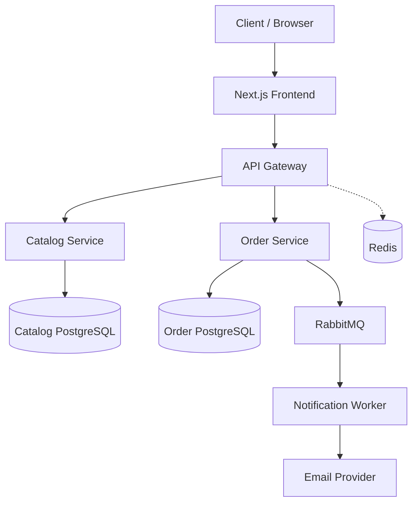

# ☁️ CloudNative Platform

### Building a Production-Style Cloud-Native Microservices Platform


**CloudNative Platform** is a hands-on engineering project focused on designing, building, deploying, and operating a cloud-native application using modern software architecture and DevOps practices.

The objective is to move beyond tutorials and develop a real, production-style system using microservices, containerization, Kubernetes, CI/CD, GitOps, observability, and cloud infrastructure.

> **Project Status:** Active Development  
> **Current Phase:** Phase 2 — Backend Microservices  
> **Next Milestone:** API Gateway implementation

---

## 🎯 Project Objectives

- Build independently deployable microservices.
- Understand real-world distributed system architecture.
- Develop REST APIs using Node.js and TypeScript.
- Implement PostgreSQL, Prisma, Redis, and RabbitMQ.
- Containerize applications with Docker.
- Deploy and manage applications using Kubernetes.
- Automate testing, building, and deployment.
- Implement GitOps workflows using Argo CD.
- Monitor systems with Prometheus, Grafana, and Loki.
- Provision AWS infrastructure using Terraform.
- Learn production-grade security and reliability practices.

---

## 🏗️ System Architecture



### Architecture Principles

1. Each microservice has a clearly defined responsibility.
2. Services communicate through APIs or asynchronous events.
3. Each service owns its data and database schema.
4. Internal services are not directly exposed to public clients.
5. Configuration is managed through environment variables.
6. Infrastructure should be reproducible and automated.
7. Applications should support health checks and graceful shutdown.
8. Logs, metrics, and traces should support troubleshooting.

---

## 🛠️ Technology Stack

| Category | Technology |
|---|---|
| Frontend | Next.js, React, Tailwind CSS |
| Language | TypeScript |
| Backend | Node.js, Express.js |
| API Validation | Zod |
| Database | PostgreSQL |
| ORM | Prisma |
| Cache | Redis |
| Messaging | RabbitMQ |
| Testing | Vitest |
| API Documentation | Swagger / OpenAPI |
| Containerization | Docker |
| Container Orchestration | Kubernetes |
| Local Kubernetes | kind |
| Kubernetes Packaging | Helm |
| Configuration Management | Kustomize |
| CI/CD | GitHub Actions |
| GitOps | Argo CD |
| Metrics | Prometheus |
| Dashboards | Grafana |
| Logging | Loki |
| Distributed Tracing | OpenTelemetry |
| Cloud Provider | AWS |
| Infrastructure as Code | Terraform |

---

## 📦 Microservices

The platform consists of four backend applications and one frontend application.

### 1. API Gateway

**Directory:** `applications/api-gateway`

The API Gateway acts as the entry point for frontend API requests.

Responsibilities:

- Request routing
- Authentication and authorization
- Input validation
- Rate limiting
- Centralized request logging
- Error handling
- Health checks
- API documentation

**Technology:** Node.js, Express.js, TypeScript, Zod

**Status:** Pending implementation

### 2. Catalog Service

**Directory:** `applications/catalog-service`

Manages the product catalog and inventory.

Responsibilities:

- Create products
- Retrieve product information
- Update products
- Delete products
- Search and filter products
- Inventory management
- PostgreSQL persistence

**Technology:** Node.js, Express.js, Prisma, PostgreSQL

**Status:** Planned

### 3. Order Service

**Directory:** `applications/order-service`

Handles customer orders and publishes order events.

Responsibilities:

- Create orders
- Retrieve order details
- Calculate order totals
- Update order status
- Cancel orders
- Persist orders in PostgreSQL
- Publish events to RabbitMQ

**Technology:** Node.js, Express.js, Prisma, PostgreSQL, RabbitMQ

**Status:** Planned

### 4. Notification Worker

**Directory:** `applications/notification-worker`

Processes asynchronous events and background jobs.

Responsibilities:

- Consume RabbitMQ messages
- Process order-created events
- Send notification emails
- Retry transient failures
- Handle failed messages
- Support dead-letter queues

**Technology:** Node.js, TypeScript, RabbitMQ, Redis (if required)

**Status:** Planned

### 5. Frontend

**Directory:** `applications/frontend`

Interactive learning dashboard and application interface.

Features:

- Cloud-native learning dashboard
- Microservices architecture visualization
- Docker learning modules
- Kubernetes learning roadmap
- Interactive playground
- Architecture exploration

**Technology:** Next.js, React, TypeScript, Tailwind CSS, Framer Motion

**Status:** Completed — backend integration pending

---

## 📁 Repository Structure

```text
cloudnative-platform/
│
├── .github/
│   └── workflows/
│
├── applications/
│   ├── api-gateway/
│   ├── catalog-service/
│   ├── frontend/
│   ├── notification-worker/
│   └── order-service/
│
├── packages/
│   ├── shared-types/
│   ├── shared-config/
│   ├── logger/
│   └── common-utils/
│
├── infrastructure/
│   ├── docker/
│   ├── kind/
│   └── scripts/
│
├── kubernetes/
│   ├── base/
│   ├── overlays/
│   ├── networking/
│   ├── security/
│   └── storage/
│
├── helm/
│   └── cloudnative-platform/
│
├── gitops/
│   └── argocd/
│
├── terraform/
│   ├── modules/
│   └── environments/
│
├── observability/
│   ├── prometheus/
│   ├── grafana/
│   ├── loki/
│   ├── otel/
│   └── alerts/
│
├── security/
├── docs/
├── tests/
├── scripts/
│
├── package.json
├── tsconfig.base.json
├── .env.example
├── .gitignore
├── Makefile
└── README.md
```

---

## 🚀 Getting Started

### Prerequisites

Install the following development tools:

- Git
- Node.js (supported LTS version)
- npm
- Docker Desktop
- Visual Studio Code

Additional technologies such as PostgreSQL, kind, Helm, and Terraform will be introduced during their respective development phases.

### Clone the Repository

```bash
git clone https://github.com/YOUR_USERNAME/cloudnative-platform.git
cd cloudnative-platform
```

Replace `YOUR_USERNAME` with your actual GitHub username.

### Install Dependencies

Once npm workspaces are configured:

```bash
npm install
```

### Environment Configuration

Environment variables will be documented in `.env.example`.

Copy the example file when configuration is available:

```bash
cp .env.example .env
```

For Windows PowerShell:

```powershell
Copy-Item .env.example .env
```

Update the values according to your local environment.

**Never commit real secrets or credentials to Git.**

### Start the Applications

Development commands will be finalized as individual services are implemented.

Each microservice will support:

- Independent startup
- Environment-based configuration
- Health checks
- Automated tests
- Production builds
- Docker deployment

---

## 🔄 Example Order Processing Workflow

The asynchronous order processing flow will operate as follows:

1. A customer submits an order from the frontend.
2. The frontend sends a request to the API Gateway.
3. The API Gateway forwards the request to the Order Service.
4. The Order Service validates and stores the order.
5. The Order Service publishes an `order.created` event.
6. RabbitMQ routes the event to the appropriate queue.
7. The Notification Worker consumes the event.
8. The worker processes and sends the notification.
9. Failed processing attempts are retried according to policy.

The planned implementation will use reliable event publishing and idempotent consumers to reduce message loss and duplicate side effects.

---

## 🐳 Docker Strategy

Each independently deployable application will have its own Dockerfile.

Planned containerized components:

- Frontend
- API Gateway
- Catalog Service
- Order Service
- Notification Worker
- PostgreSQL
- Redis
- RabbitMQ

Docker Compose will provide a reproducible local development environment.

---

## ☸️ Kubernetes Strategy

Kubernetes deployment will begin after services can run successfully with Docker.

The learning and implementation plan includes:

- Pods and Deployments
- Services and namespaces
- Labels and selectors
- ConfigMaps and Secrets
- PersistentVolumes and PersistentVolumeClaims
- Ingress
- Liveness and readiness probes
- Resource requests and limits
- Horizontal Pod Autoscaling
- Rolling updates
- Helm charts
- Kustomize overlays

Local Kubernetes development will use **kind**.

---

## 🔁 CI/CD and GitOps

Planned GitHub Actions workflows:

1. Install dependencies
2. Run linting and type checks
3. Execute automated tests
4. Build applications
5. Build Docker images
6. Scan container images
7. Push versioned images to a container registry
8. Update deployment configurations

Argo CD will be introduced for GitOps-based Kubernetes deployment synchronization.

---

## 📊 Observability

The platform will integrate monitoring and troubleshooting tools.

| Tool | Responsibility |
|---|---|
| Prometheus | Metrics collection |
| Grafana | Monitoring dashboards |
| Loki | Centralized logging |
| OpenTelemetry | Distributed tracing and telemetry |
| Alerting Rules | Detect system failures and reliability issues |

Example metrics:

- HTTP request latency
- Request error rates
- Service availability
- CPU and memory consumption
- RabbitMQ queue depth
- Order processing failures

---

## 🔐 Security Goals

Planned security practices:

- Environment-based secrets management
- Authentication and authorization
- API rate limiting
- Input validation
- Least-privilege permissions
- Kubernetes RBAC
- Kubernetes NetworkPolicies
- Container vulnerability scanning
- Secure dependency management
- Non-root container execution
- HTTPS for public endpoints

---

## 🗺️ Development Roadmap

| Phase | Description | Status |
|---|---|---|
| 1 | Next.js Frontend | ✅ Completed |
| 2 | Backend Microservices | 🔄 Current |
| 3 | Database and Messaging | ⏳ Pending |
| 4 | Frontend Integration | ⏳ Pending |
| 5 | Docker Containerization | ⏳ Pending |
| 6 | Kubernetes Fundamentals | ⏳ Pending |
| 7 | Advanced Kubernetes | ⏳ Pending |
| 8 | Helm and Kustomize | ⏳ Pending |
| 9 | CI/CD and GitOps | ⏳ Pending |
| 10 | Observability and Security | ⏳ Pending |
| 11 | AWS Deployment with Terraform | ⏳ Pending |

### Current Milestone: API Gateway

Implementation checklist:

- [ ] Inspect existing project configuration
- [ ] Configure Express and TypeScript
- [ ] Implement environment validation
- [ ] Add health endpoint
- [ ] Configure request logging
- [ ] Implement centralized error handling
- [ ] Add graceful shutdown
- [ ] Configure service routing
- [ ] Validate API inputs using Zod
- [ ] Add OpenAPI documentation
- [ ] Write unit and integration tests
- [ ] Verify TypeScript build
- [ ] Verify application startup
- [ ] Verify automated tests

---

## 🧪 Testing Strategy

The platform will use Vitest for automated testing.

Testing will include:

- Unit tests for business logic
- API integration tests
- Request validation tests
- Health endpoint tests
- Service communication tests
- Database integration tests
- Message processing tests

Every service should build and pass its tests before the next service is implemented.

---

## ☁️ AWS Deployment Plan

The final cloud deployment will introduce:

- Amazon EKS for Kubernetes
- Amazon ECR for container images
- Amazon RDS for PostgreSQL
- AWS networking and IAM
- Application Load Balancer integration
- CloudWatch integration where appropriate
- Terraform-managed infrastructure

Managed messaging and caching options will be evaluated during the AWS phase.

The aim is to produce a reproducible, observable, and secure cloud deployment.

---

## 📚 Learning Outcomes

By completing this project, I aim to gain practical experience in:

- Backend engineering
- Microservices architecture
- Distributed systems
- Database management
- Event-driven architecture
- Docker containerization
- Kubernetes administration
- Infrastructure automation
- CI/CD pipelines
- GitOps deployment
- Cloud security
- Production observability
- AWS infrastructure engineering

---

## 🧭 Development Philosophy

**Build → Test → Containerize → Deploy → Monitor → Improve**

This project is being developed incrementally.

Each phase focuses on understanding the technology, implementing it in a working application, validating the result, and documenting the lessons learned.

The goal is not simply to deploy an application, but to understand how modern cloud-native systems are engineered and operated.

---

## 📌 Project Status

This repository is actively under development.

The frontend is complete. Backend services, container orchestration, deployment automation, and observability will be implemented progressively.

Documentation and setup instructions will evolve as each milestone is completed.

---

## 📄 License

No license has been selected yet.

All rights reserved unless a license is added to this repository.
